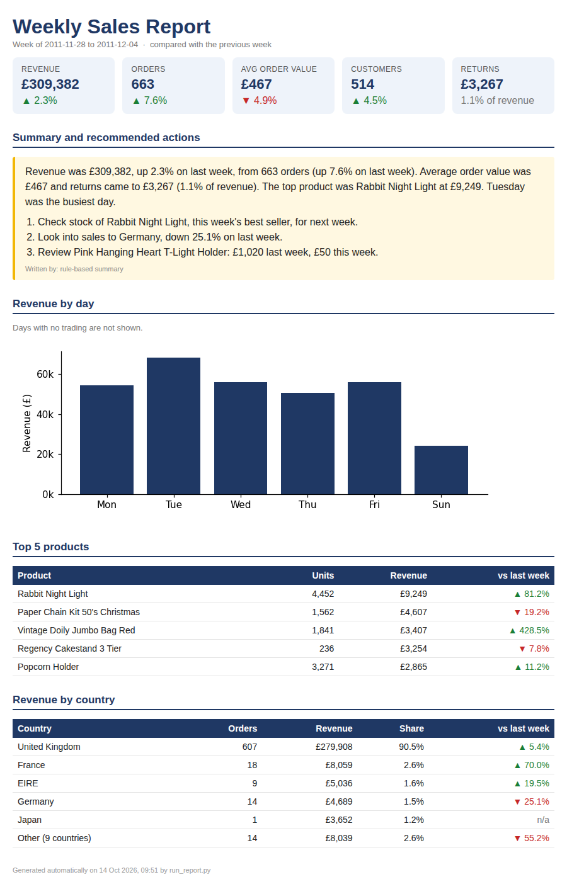

# Automated weekly sales report

Every Monday, someone usually has to pull last week's numbers, compare them with the week before and write a few lines for the manager. This script does that in one command. It reads the data from MySQL, works out the KPIs, writes a short summary with suggested actions, saves a formatted HTML report and can email it.



The full sample is [`sample_output/weekly_report_2011-12-04.html`](sample_output/weekly_report_2011-12-04.html).

## Data

[E-Commerce Data](https://www.kaggle.com/datasets/carrie1/ecommerce-data) on Kaggle, which is the UCI *Online Retail* dataset. It has 541,909 real invoice lines from a UK online gift shop, December 2010 to December 2011.

The raw file needed cleaning before it was usable. `load_data.py` does this once and loads the result into MySQL:

- 5,268 exact duplicate lines removed
- 2,512 lines with a zero or negative price removed (these are stock adjustments, not sales)
- 2,924 non-product lines removed: postage, bank charges, Amazon fees and manual adjustments
- 8,668 cancelled lines (invoice numbers starting with "C") kept, but marked as returns
- 131,549 lines have no customer ID; they still count towards revenue, just not towards customer numbers

That leaves 531,205 lines. The shop never trades on Saturdays, which is why the daily chart only has six bars.

## What's in the report

- Revenue, orders, average order value, customers and returns, each compared with last week
- A short summary with three suggested actions
- Revenue by day
- Top 5 products
- Revenue by country (in the sample week, the UK was 90% of sales)

## The summary

`report/insights.py` writes the summary from simple rules. It picks out the top product, the country with the biggest drop, the product that fell the most, and whether returns were unusually high, then turns those into a short paragraph and three suggested actions.

## Emailing the report

`python run_report.py --email` sends the summary as the email text, with the full HTML report attached. The SMTP details go in `.env`. For Gmail, use `smtp.gmail.com`, port 587 and an app password, not your normal password. `tests/test_email.py` checks the email using a fake mail server, so nothing is actually sent.

## Setup

You need Python 3.10+ and MySQL 8.

```bash
pip install -r requirements.txt
cp .env.example .env          # MySQL details, plus email settings if you want them
# in MySQL: CREATE DATABASE online_retail;
# download data.csv from Kaggle into data/ (see data/README.md)
python load_data.py
```

## Running it

```bash
python run_report.py                            # last full week in the data
python run_report.py --week-ending 2011-11-27   # a specific week (must be a Sunday)
python run_report.py --email                    # build it and email it
pytest                                          # tests use SQLite, so no MySQL needed
```

To run it every Monday at 8am:

- **Linux/Mac:** add this to cron: `0 8 * * 1 cd /path/to/project && venv/bin/python run_report.py --email >> logs/report.log 2>&1`
- **Windows:** Task Scheduler → Create Basic Task → Weekly, Monday 8:00 → program `python.exe`, argument `run_report.py --email`, start in the project folder.

The dataset stops in December 2011, so with this data the "last full week" is always the week ending 4 December 2011. On live data it would be last week.

## Files

- `run_report.py` – main script
- `load_data.py` – cleans the raw file and loads it into MySQL
- `report/kpis.py` – SQL queries and the week-over-week maths
- `report/insights.py` – writes the summary and suggested actions
- `report/render.py` – chart and HTML
- `report/emailer.py` – sends the email
- `templates/weekly_report.html` – report layout
- `tests/` – KPI, cleaning and email tests
